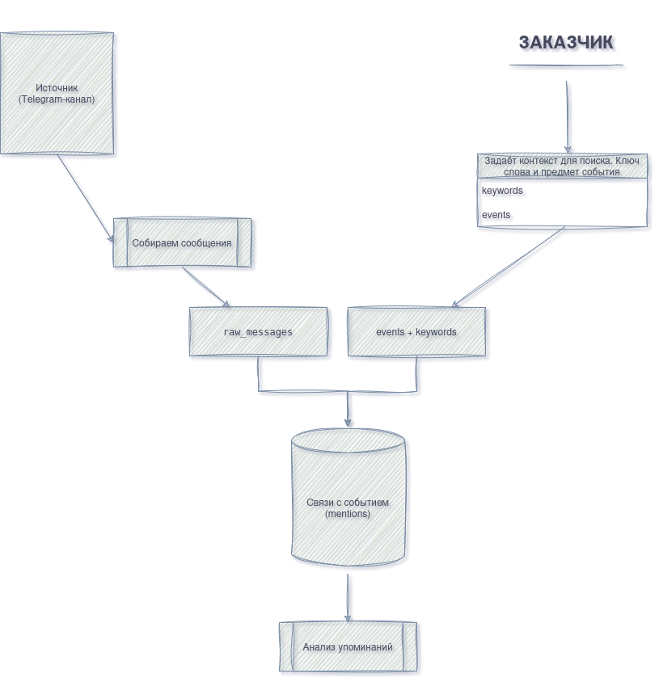

<h1 align="center">
  <a href="https://git.io/typing-svg">
    
  </a>
</h1>

<p align="center">
  Мониторинг упоминаний бренда и продуктов в одном месте.
</p>

<p align="center">
  
  
  
</p>

---

## О проекте

**FIZZY** — проект для мониторинга упоминаний компании и её продуктов. Он помогает понять, что пишет аудитория, как меняется тональность сообщений и восприятие бренда.

Проект находится в разработке.

## Что есть сейчас

- Telegram-бот с командами `/start` и `/help`.
- Модели данных для событий, источников, сообщений, персон и упоминаний.
- Основа для дальнейшей обработки сообщений.

## Как будет работать система

<p align="center">
  
  <br>
  <sub>Путь сообщения от источника до результата мониторинга</sub>
</p>

```text
Источники → Сбор сообщений → raw_messages → Обработка → mentions → Результат
```

Текст сообщения хранится в `raw_messages`, а его связь с событием — в `mentions`. Персоны используются для создания синтетических публикаций.

## Быстрый старт

Понадобятся **Python 3.13**, **uv** и **PostgreSQL**.

```bash
uv venv
source .venv/bin/activate
uv sync
```

Создай файл окружения:

```bash
cp .env.example .env
```

Укажи в `.env` свои значения `BOT_TOKEN` и `DATABASE_URL`. Создай таблицы и проверь подключение:


## Запуск БД

Обычный запуск
1) открываем Docker Desktop и запусти существующий контейнер fizzy-db. 
2) Убедись, что контейнер имеет статус Running. Он публикует PostgreSQL на localhost:5433
3) Запускай Python-код проекта. Он берёт параметры подключения из .env:

```bash
DATABASE_URL=postgresql+asyncpg://fizzy_app:<пароль>@localhost:5433/fizzy
```
4) В DBeaver подключайся к localhost, порт 5433, база fizzy, пользователь fizzy_app и тот же пароль.

# Как создать таблицу?

Таблицу, которая будет занесена в наушу будущую БД:
```bash
uv run python -m db.init_db
```
*Примичание: команда берёт описание таблиц из db/models.py и создаёт описанную в файле таблицу (При обычном включении Docker повторять init_db не требуется. create_all также не обновляет структуру существующей таблицы после изменения модели.)