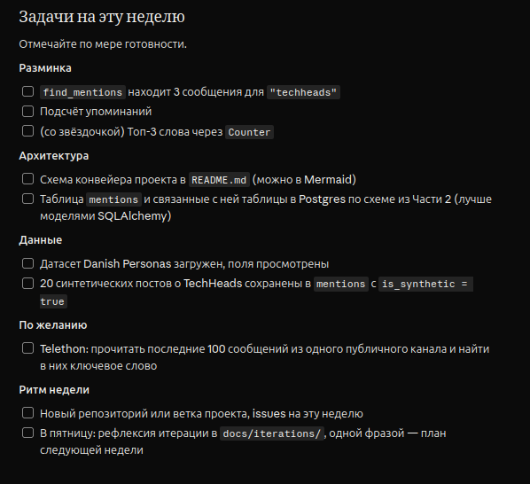

Ниже порядок, в котором я бы выполнял 10-й спринт. После каждого этапа есть проверка: она покажет, можно ли двигаться дальше.
1. Закончить разминку. Возьми несколько учебных сообщений, напиши find_mentions(messages, keyword) и проверь, что для techheads она возвращает ровно 3 сообщения. Затем выведи их количество. Топ-3 слова через Counter сделай в конце — в чек-листе это дополнительное задание.
2. Нарисовать конвейер в README. Добавь в [README.md](/media/drdong654/Data/it/FIZZY/README.md) схему «источник → сбор → raw_messages → обработка → mentions → выдача». Подпиши, что personas используются для синтетических постов. Готово, когда: по схеме понятно, где хранится текст сообщения и где хранится его связь с событием.
3. Проверить и запустить схему БД. Модели уже есть в [models.py](/media/drdong654/Data/it/FIZZY/db/models.py). Согласуй тип RawMessage.text с nullable=False, затем настрой подключение к PostgreSQL в [database.py](/media/drdong654/Data/it/FIZZY/db/database.py). Создай таблицы из моделей и проверь, что можно записать и прочитать событие, источник, сообщение и упоминание. Если будешь использовать [schema.sql](/media/drdong654/Data/it/FIZZY/db/schema.sql), сначала исправь синтаксис таблицы keywords; достаточно выбрать один способ создания таблиц.
4. Посмотреть датасет. Загрузи Danish Personas, выведи названия полей и одну запись. Сопоставь реальные поля с Persona: возраст, пол, регион, занятие, черты характера и описание. Готово, когда: понятно, какие значения и в каком виде записывать в каждую колонку. После этого выбери 20 персон с фиксированным seed=42, чтобы результат можно было повторить.
5. Подготовить записи для TechHeads. Создай в БД событие TechHeads и источник с kind="synthetic". Для каждой из 20 персон подготовь короткий английский пост о конференции от её лица. Передавай генератору описание и черты характера персоны; настроение постов должно различаться.
6. Сохранить 20 постов. Для каждого результата запиши персону в personas, текст поста в raw_messages, а связь поста с событием и персоной — в mentions. У каждой связи установи is_synthetic=True. Готово, когда: запрос к БД возвращает 20 таких mentions, и для каждого доступны текст сообщения, событие и персона.
7. Оформить результат недели. Зафиксируй работу в Git, заведи issues для незаконченных задач. В docs/iterations/ запиши короткую рефлексию и одной фразой — план следующей недели.
После этого вернись к дополнительным заданиям: топ-3 слова через Counter и Telethon для публичного канала. Ближайший практический шаг — этап 1, затем README; модели повторно писать уже не требуется.

